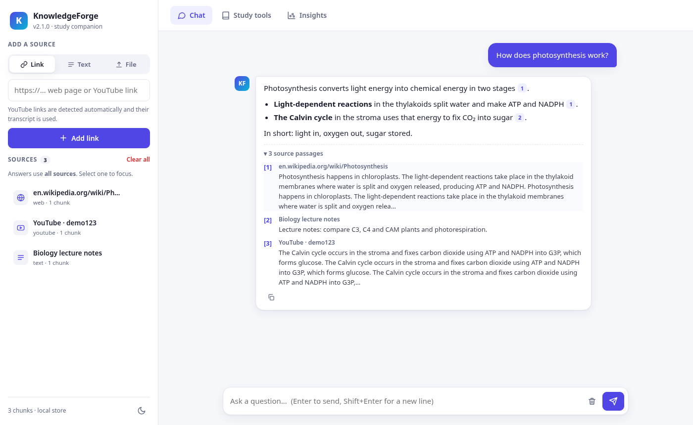
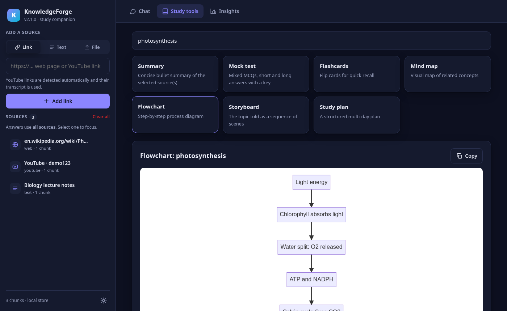
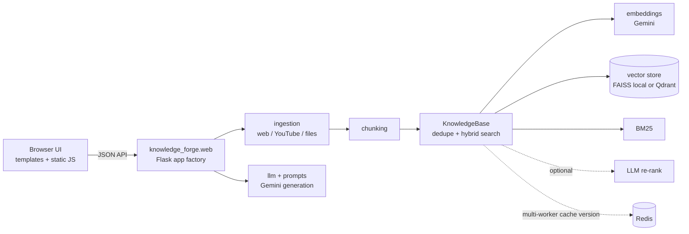

# KnowledgeForge

[](https://github.com/nisaral/Knowledge_forge/actions/workflows/ci.yml)


KnowledgeForge is a small Flask app for retrieval-augmented learning. You add sources (web pages, YouTube
transcripts, pasted text, PDFs, Markdown, audio, video and images), then chat with them and get cited
answers. It can also produce summaries, flashcards, quizzes, Mermaid flowcharts, entity lists and topic
clusters. Gemini handles embeddings and generation.



| Study tools (dark) | Mobile |
|---|---|
|  |  |

## Features

- **Ingestion:** web pages (SSRF-guarded, re-checked on every redirect), YouTube transcripts, text, `.txt`/`.md`, PDFs (PyMuPDF, with a Gemini fallback for scanned files), and audio, video and images (Gemini file API).
- **Hybrid retrieval:** BM25 and dense (FAISS or Qdrant) scores are fused with weights. An optional Gemini re-rank step follows. Chunks are deduplicated by content hash.
- **Grounded chat:** answers carry `[n]` citations that link to source snippets. Multi-turn history is stored in the browser (localStorage), and you can scope a chat to a single source.
- **Study tools:** summary, flashcards, quiz, Mermaid flowchart, entity extraction and topic clustering (k-means plot).
- **UI:** vanilla JS with no build step. It includes light and dark themes, drag-and-drop upload, toasts, skeleton loaders and a responsive mobile drawer. Markdown is rendered XSS-safely, and Mermaid runs with `securityLevel: strict`.

## Architecture



| Module | Responsibility |
|---|---|
| `app.py` | Thin entry point (`app = create_app()`), used by gunicorn as `app:app` |
| `knowledge_forge/config.py` | Typed settings loaded from environment variables |
| `knowledge_forge/web.py` | Routes, validation and error handling |
| `knowledge_forge/ingestion.py` | URL validation, crawling, transcripts and file extraction |
| `knowledge_forge/knowledge_base.py` | Chunk storage, deduplication and hybrid search |
| `knowledge_forge/vector_store/` | Local FAISS store and Qdrant store |
| `knowledge_forge/llm.py`, `prompts.py` | Gemini calls with retries, and prompt templates |

## Setup

Requires Python 3.10–3.12 and a [Gemini API key](https://aistudio.google.com/).

```bash
git clone https://github.com/nisaral/Knowledge_forge.git
cd Knowledge_forge
python -m venv .venv && source .venv/bin/activate
pip install -r requirements.txt
cp .env.example .env   # then fill in GEMINI_API_KEY and FLASK_SECRET
```

## Run

```bash
python app.py                                   # dev server on http://127.0.0.1:5000 (HOST/PORT/FLASK_DEBUG)
gunicorn -c gunicorn.conf.py app:app            # production-style
docker compose up --build                       # app + Qdrant + Redis on :8000 (needs FLASK_SECRET in .env)
```

## Configuration

All settings come from environment variables. `.env.example` lists them all.

| Variable | Default | Notes |
|---|---|---|
| `GEMINI_API_KEY` | – | Required (`GOOGLE_API_KEY` is also accepted) |
| `FLASK_SECRET` | random per process | Set it in production |
| `GEN_MODEL` / `EMBED_MODEL` | `gemini-2.0-flash` / `models/gemini-embedding-001` | |
| `EMBED_DIM` | `768` | |
| `CHUNK_SIZE` / `CHUNK_OVERLAP` | `400` / `50` | In words |
| `SEMANTIC_WEIGHT` / `BM25_WEIGHT` | `0.7` / `0.3` | Fusion weights |
| `TOP_K_COARSE` / `TOP_K_FINAL` | `12` / `5` | |
| `RERANK` | `true` | LLM re-ranking of the coarse hits |
| `CHAT_HISTORY_TURNS` | `6` | |
| `VECTOR_STORE` | `local` | `local` (FAISS on disk in `DATA_DIR`) or `qdrant` |
| `DATA_DIR` | `data` | |
| `QDRANT_URL` / `QDRANT_API_KEY` / `QDRANT_COLLECTION` | `http://localhost:6333` / – / `knowledge_forge` | |
| `REDIS_URL` | – | Optional; keeps caches consistent across workers |
| `MAX_UPLOAD_MB` | `50` | |
| `ALLOW_PRIVATE_URLS` | `false` | Leave off unless you trust every user |
| `CORS_ORIGINS` | – | Comma-separated; CORS is off when this is empty |
| `GUNICORN_WORKERS` / `GUNICORN_THREADS` / `GUNICORN_TIMEOUT` | – / `8` / `180` | |

## Tests and lint

```bash
pip install -r requirements-dev.txt
ruff check .
pytest -q                 # offline: Gemini and the network are mocked
pytest -m network         # optional live checks (needs internet)
```

CI (`.github/workflows/ci.yml`) runs ruff and then pytest on Python 3.10, 3.11 and 3.12, and finally a Docker build.

## Limitations

- Gemini is the only model provider, and nothing works without an API key.
- The `local` store keeps everything in one process, so use `qdrant` (plus `REDIS_URL`) when running several gunicorn workers.
- There is no authentication or multi-tenancy. Every visitor shares one knowledge base.
- YouTube ingestion depends on public transcripts, and some videos have none or are blocked by region or bot checks.
- Crawling takes static HTML only, so JavaScript-rendered pages may yield little text.
- Retrieval quality has not been formally benchmarked.

## Roadmap

- Migrate from the deprecated `google-generativeai` SDK to `google-genai`.
- Add per-user workspaces and authentication.
- Stream chat responses (SSE).
- Run ingestion as background jobs with progress reporting.
- Add a pluggable model provider (OpenAI-compatible or local models).
- Add a retrieval evaluation harness.

## Contributing / License

See [CONTRIBUTING.md](CONTRIBUTING.md). Licensed under the [MIT License](LICENSE).
