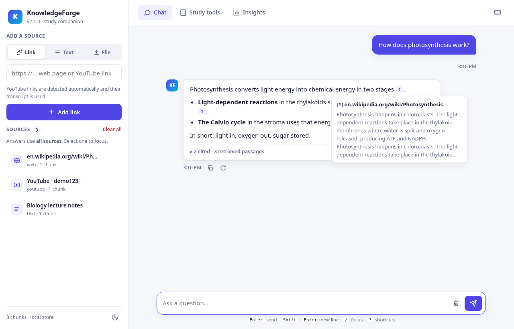
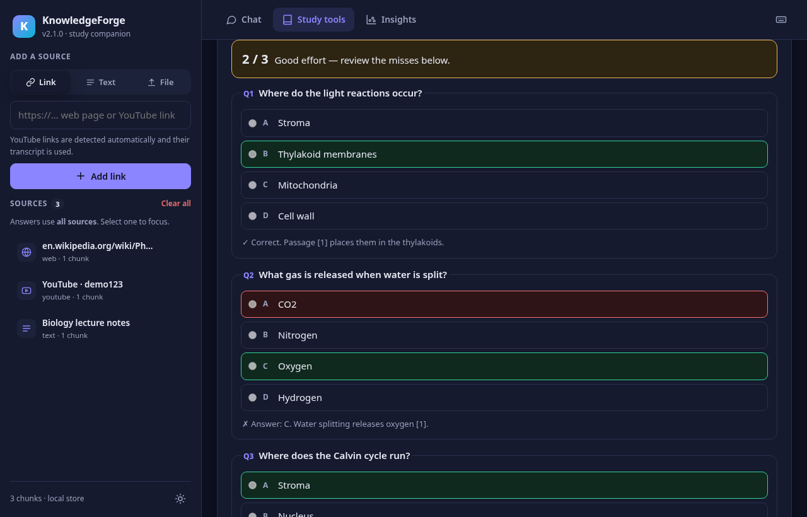
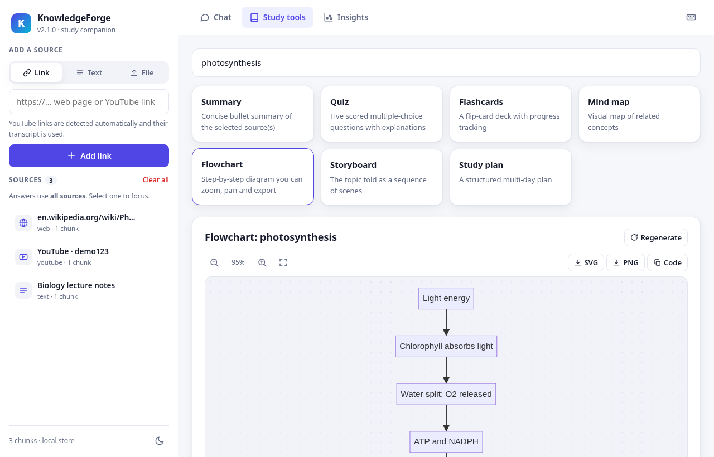
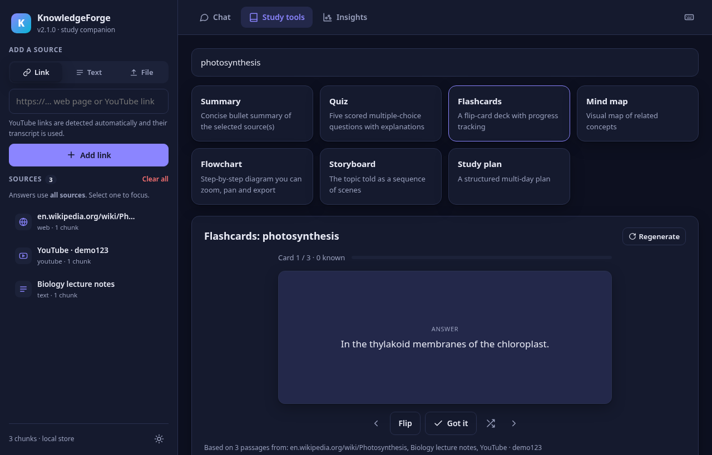
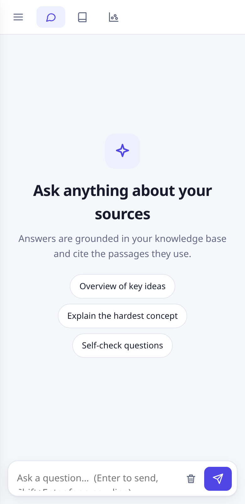
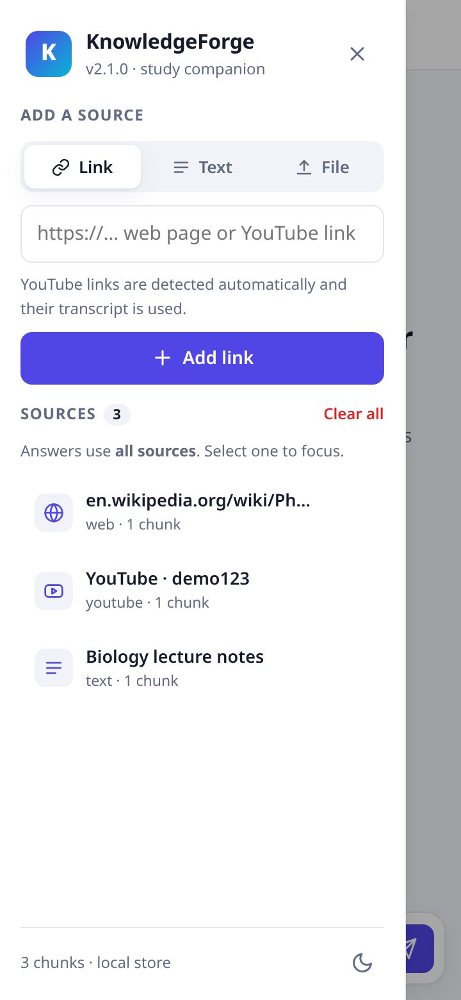
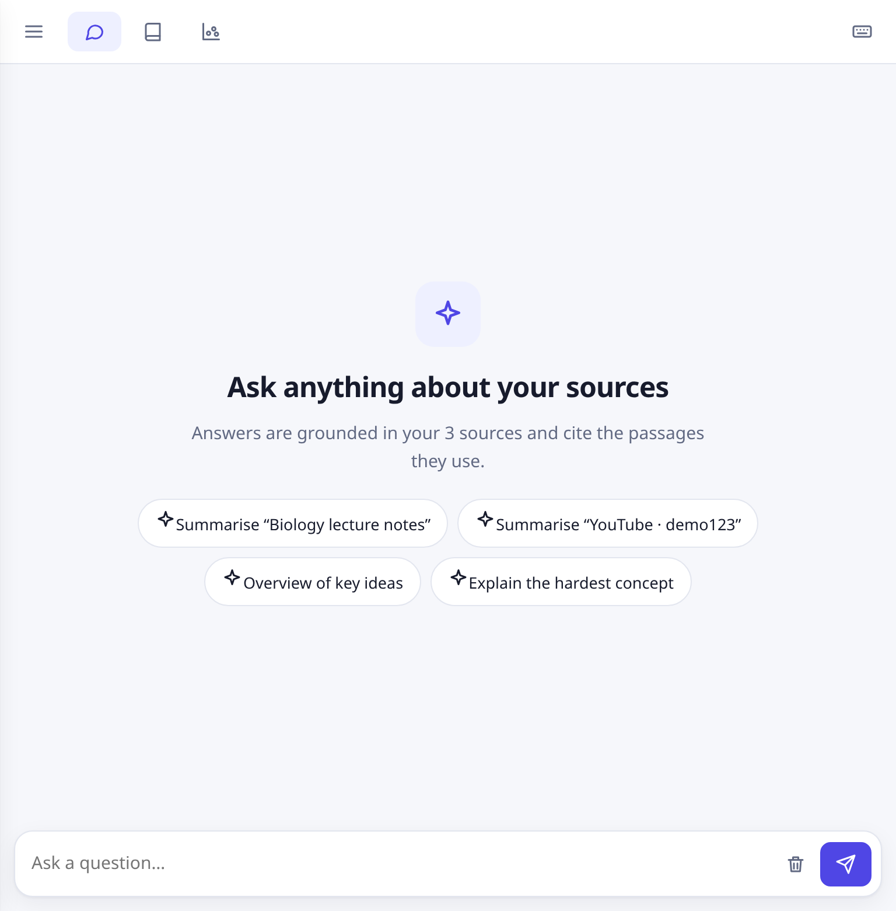
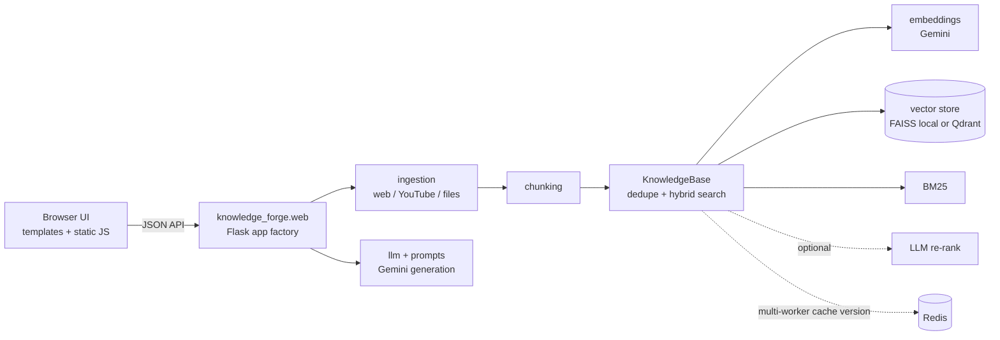

# KnowledgeForge

[](https://github.com/nisaral/Knowledge_forge/actions/workflows/ci.yml)


KnowledgeForge is a small Flask app for retrieval-augmented learning. You add sources (web pages, YouTube
transcripts, pasted text, PDFs, Markdown, audio, video and images), then chat with them and get cited
answers. It can also produce summaries, flashcards, quizzes, Mermaid flowcharts, entity lists and topic
clusters. Gemini handles embeddings and generation.



| Quiz with scoring (dark) | Flowchart viewer | Flashcards |
|---|---|---|
|  |  |  |

| Mobile (360 px) | Mobile sidebar | Tablet (768 px) |
|---|---|---|
|  |  |  |

The screenshots use a demo server with a mocked model, so the answers in them are illustrative.

## Features

- **Ingestion:** web pages (SSRF-guarded, re-checked on every redirect), YouTube transcripts, text, `.txt`/`.md`, PDFs (PyMuPDF, with a Gemini fallback for scanned files), and audio, video and images (Gemini file API).
- **Hybrid retrieval:** BM25 and dense (FAISS or Qdrant) scores are fused with weights. An optional Gemini re-rank step follows. Chunks are deduplicated by content hash.
- **Grounded chat:** answers carry `[n]` citations that link to source snippets. Multi-turn history is stored in the browser (localStorage), and you can scope a chat to a single source.
- **Study tools:** summary; a scored multiple-choice quiz with explanations and review (`mock_test` is an alias); a flip-card flashcard deck with progress, shuffle and keyboard control; Mermaid flowcharts and mind maps with zoom, pan, fit, and SVG/PNG export; storyboard; study plan; entity extraction and topic clustering (k-means plot).
- **Chat UI:** answers stream token by token over Server-Sent Events (`/api/chat/stream`), and you can stop them. Each message has copy and regenerate buttons and a timestamp. Hovering or focusing a `[n]` citation previews its passage. Passages the answer did not cite are dimmed, and an answer that cites none is flagged "Not from your sources". Suggested questions are built from your latest sources. The view scrolls with the stream only while you are at the bottom; otherwise a "Latest" button appears.
- **UI:** vanilla JS with no build step. It has light and dark themes (the choice is saved and defaults to the system setting), drag-and-drop upload, toasts, skeleton loaders, and empty and error states with retry. Layouts are responsive from 360 px phones to desktops. It includes a skip link, ARIA tabs, live regions and labelled controls. Markdown is rendered XSS-safely, Mermaid runs with `securityLevel: strict`, and there are no inline scripts, so the CSP `script-src 'self'` holds.
- **Keyboard shortcuts:** `/` focuses the composer, `Ctrl/⌘+K` adds a link, `Alt+1..3` switches tabs, `Esc` stops generation, `Space` and `←`/`→` drive the flashcards, and `?` lists all the shortcuts.

## Architecture



| Module | Responsibility |
|---|---|
| `app.py` | Thin entry point (`app = create_app()`), used by gunicorn as `app:app` |
| `knowledge_forge/config.py` | Typed settings loaded from environment variables |
| `knowledge_forge/web.py` | Routes, validation and error handling |
| `knowledge_forge/ingestion.py` | URL validation, crawling, transcripts and file extraction |
| `knowledge_forge/knowledge_base.py` | Chunk storage, deduplication and hybrid search |
| `knowledge_forge/vector_store/` | Local FAISS store and Qdrant store |
| `knowledge_forge/llm.py`, `prompts.py` | Gemini calls with retries, and prompt templates |

## Setup

Requires Python 3.10–3.12 and a [Gemini API key](https://aistudio.google.com/).

```bash
git clone https://github.com/nisaral/Knowledge_forge.git
cd Knowledge_forge
python -m venv .venv && source .venv/bin/activate
pip install -r requirements.txt
cp .env.example .env   # then fill in GEMINI_API_KEY and FLASK_SECRET
```

## Run

```bash
python app.py                                   # dev server on http://127.0.0.1:5000 (HOST/PORT/FLASK_DEBUG)
gunicorn -c gunicorn.conf.py app:app            # production-style
docker compose up --build                       # app + Qdrant + Redis on :8000 (needs FLASK_SECRET in .env)
```

## Configuration

All settings come from environment variables. `.env.example` lists them all.

| Variable | Default | Notes |
|---|---|---|
| `GEMINI_API_KEY` | – | Required (`GOOGLE_API_KEY` is also accepted) |
| `FLASK_SECRET` | random per process | Set it in production |
| `GEN_MODEL` / `EMBED_MODEL` | `gemini-2.0-flash` / `models/gemini-embedding-001` | |
| `EMBED_DIM` | `768` | |
| `CHUNK_SIZE` / `CHUNK_OVERLAP` | `400` / `50` | In words |
| `SEMANTIC_WEIGHT` / `BM25_WEIGHT` | `0.7` / `0.3` | Fusion weights |
| `TOP_K_COARSE` / `TOP_K_FINAL` | `12` / `5` | |
| `RERANK` | `true` | LLM re-ranking of the coarse hits |
| `CHAT_HISTORY_TURNS` | `6` | |
| `VECTOR_STORE` | `local` | `local` (FAISS on disk in `DATA_DIR`) or `qdrant` |
| `DATA_DIR` | `data` | |
| `QDRANT_URL` / `QDRANT_API_KEY` / `QDRANT_COLLECTION` | `http://localhost:6333` / – / `knowledge_forge` | |
| `REDIS_URL` | – | Optional; keeps caches consistent across workers |
| `MAX_UPLOAD_MB` | `50` | |
| `ALLOW_PRIVATE_URLS` | `false` | Leave off unless you trust every user |
| `CORS_ORIGINS` | – | Comma-separated; CORS is off when this is empty |
| `MIN_RELEVANCE` | `0.0` | Drop fused hits scoring below this (0–1) |
| `EMBED_FALLBACK_MODELS` | `models/gemini-embedding-001,models/text-embedding-004` | Comma-separated embedding models to try if `EMBED_MODEL` is unavailable |
| `LLM_TEMPERATURE` / `LLM_MAX_OUTPUT_TOKENS` | `0.3` / `0` (model default) | |
| `GEMINI_TIMEOUT_SECONDS` | `60` | Per-request timeout for Gemini calls |
| `LLM_MAX_RETRIES` / `LLM_RETRY_BASE_SECONDS` / `LLM_RETRY_MAX_SECONDS` | `3` / `1.0` / `8.0` | Exponential backoff with jitter on 408/429/5xx and timeouts |
| `SUMMARY_MAX_CHARS` / `ENTITY_MAX_CHARS` | `24000` / `6000` | Context budget, sampled evenly across sources |
| `CLUSTER_MIN_CHUNKS` / `CLUSTER_MAX_TOPICS` | `5` / `5` | Topic map |
| `CRAWL_TIMEOUT_SECONDS` / `CRAWL_MAX_BYTES` / `CRAWL_MAX_REDIRECTS` | `15` / `5242880` / `5` | Every redirect hop and the connected IP are re-checked |
| `RENDER_JS` | `never` | `auto` renders a page in headless Chromium when the static HTML has little text or is a SPA shell; `always` renders every page. See [JavaScript rendering](#javascript-rendering) |
| `RENDER_JS_TIMEOUT_SECONDS` / `RENDER_JS_MAX_CONCURRENCY` / `RENDER_JS_MAX_REQUESTS` | `20` / `2` / `150` | Per page deadline, simultaneous browser pages, subrequests per page |
| `RENDER_JS_SETTLE_MS` / `RENDER_JS_MIN_CHARS` / `RENDER_JS_BROWSER_PATH` | `1500` / `500` / – | Wait for network idle; `auto` threshold; optional Chromium/Chrome binary |
| `CRAWL_RESPECT_ROBOTS` | `true` | Refuse pages that the site's robots.txt disallows for `CRAWL_USER_AGENT` |
| `CRAWL_USER_AGENT` | `KnowledgeForge/2 (+repo URL)` | |
| `YOUTUBE_LANGUAGES` | `en,en-US,en-GB` | Transcript language preference |
| `YOUTUBE_METADATA_FALLBACK` | `false` | When a video has no transcript, ask Gemini to describe it (may be inaccurate) |
| `PDF_OCR_MIN_CHARS` | `100` | Below this much extracted text a PDF is sent to Gemini for OCR |
| `RATE_LIMIT_PER_MINUTE` | `30` | Per client IP, per worker, on LLM-backed endpoints; `0` disables |
| `TRUSTED_PROXIES` | `0` | Number of reverse proxies whose `X-Forwarded-*` headers to trust |
| `FAISS_NPROBE` / `QDRANT_TIMEOUT_SECONDS` | `16` / `30` | |
| `HOST` / `PORT` / `FLASK_DEBUG` | `127.0.0.1` / `5000` / `false` | Dev server only |
| `LOG_LEVEL` / `LOG_FORMAT` | `INFO` / `text` | `LOG_FORMAT=json` for structured logs; secrets are redacted |
| `GUNICORN_WORKERS` / `GUNICORN_THREADS` / `GUNICORN_TIMEOUT` | `1` (`2` with Qdrant) / `8` / `180` | More than one worker requires `VECTOR_STORE=qdrant` |
| `GUNICORN_GRACEFUL_TIMEOUT` / `GUNICORN_KEEPALIVE` | `30` / `5` | |

## JavaScript rendering

Single-page apps and lazy-loaded pages can be crawled through a headless Chromium. It is optional and off by default.

```bash
pip install -r requirements-js.txt          # or: pip install ".[js]"
playwright install --with-deps chromium
RENDER_JS=auto python app.py
```

- With `RENDER_JS=auto` the crawler fetches the static HTML first and renders only when it has little text (`RENDER_JS_MIN_CHARS`) or looks like an app shell; it keeps whichever text is longer.
- The **Render JavaScript** checkbox in the Link panel turns rendering on or off per URL. It is disabled when the server has `RENDER_JS=never` or the browser is not installed.
- Chromium never touches the network directly. Every request, including redirects, goes through the same SSRF-guarded client as the static crawler, so navigations and subrequests to private or loopback addresses are blocked. Images, media, fonts, WebSockets and service workers are blocked too.
- Pages are capped by `RENDER_JS_TIMEOUT_SECONDS`, `RENDER_JS_MAX_REQUESTS`, `CRAWL_MAX_BYTES` and `RENDER_JS_MAX_CONCURRENCY`.
- If Playwright or Chromium is missing, the request fails with an error that says how to install them, and `auto` falls back to the static text when there is enough of it.
- Docker: `docker build --build-arg INSTALL_JS=true -f dockerfile .` bakes Chromium into the image (about 400 MB larger). The default image does not include it.

## Tests and lint

```bash
pip install -r requirements-dev.txt
ruff check .
pytest -q                 # offline: Gemini and the network are mocked
pytest -m network         # optional live checks (needs internet)
```

CI (`.github/workflows/ci.yml`) runs ruff and then pytest on Python 3.10, 3.11 and 3.12, a JavaScript-rendering job with real Chromium, and finally a Docker build.

## Limitations

- Gemini is the only model provider, and nothing works without an API key.
- The `local` store keeps everything in one process, so use `qdrant` (plus `REDIS_URL`) when running several gunicorn workers.
- There is no authentication or multi-tenancy. Every visitor shares one knowledge base.
- YouTube ingestion depends on public transcripts, and some videos have none or are blocked by region or bot checks.
- JavaScript rendering is opt-in (`RENDER_JS`) and needs Playwright plus Chromium; without it, JavaScript-rendered pages may yield little text.
- Retrieval quality has not been formally benchmarked.
- The rate limiter is in memory, so the limit applies per worker process.

## Roadmap

- Add per-user workspaces and authentication.
- Run ingestion as background jobs with progress reporting.
- Add a pluggable model provider (OpenAI-compatible or local models).
- Add a retrieval evaluation harness.

## Contributing / License

See [CONTRIBUTING.md](CONTRIBUTING.md). Licensed under the [MIT License](LICENSE).


> **Testing status:** see [docs/TESTING.md](docs/TESTING.md). In the live run with a real Gemini key, the embeddings were real. Every generation call was rate-limited (HTTP 429), so the storyboard, flashcard and graph screenshots in `docs/e2e/` show the built-in text fallback, not model output.
